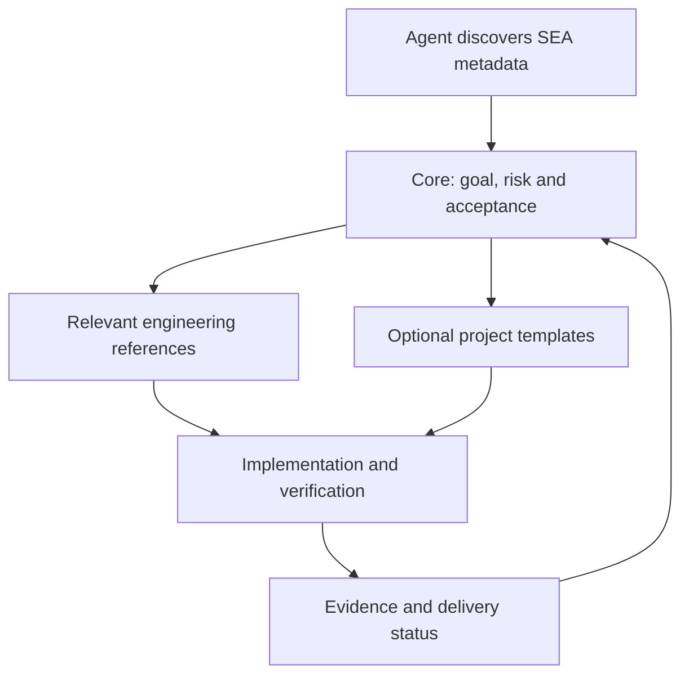

# SEA

**Software Engineering Assistant** - a portable, risk-based engineering skill for AI coding assistants.

[English](README.md) | [简体中文](README.zh-CN.md)

SEA turns software goals into explicit requirements, proportionate design, reviewable implementation, and verification evidence. The skill and its references are written in English; assistants should still communicate in the user's preferred language.

## Quick start

Install using the third-party [skills CLI](https://github.com/vercel-labs/skills) with Node.js 22.20+ and npm:

```sh
npx skills add quyuchao/SEA --skill sea
```

Choose your agent, or specify one:

```sh
npx skills add quyuchao/SEA --skill sea -a codex
npx skills add quyuchao/SEA --skill sea -a claude-code
```

Run in the target project; add `-g` for user-level installation. Reload the host as required. Ask it to use SEA (`$sea` where supported) and identify the actual core file read, task risk and relevant references. Installation, host discovery and actual task selection are separate states. Automatic selection depends on the host; ordinary ChatGPT conversations cannot register skills merely by opening a URL. These commands follow the installer interface; end-to-end installation testing remains pending.

Use `npx skills list` to inspect installation, `npx skills check` for updates and `npx skills remove sea` to remove. Review installed destinations before removing or updating shared skills.

## Architecture



`sea/` is the installable package. The core routes to references only when relevant. Repository documentation and CI serve maintainers; `SEA.md` is a generated chat-only fallback, not the normal loading path.

See [architecture review](docs/architecture-review.md) for priorities and evidence boundaries.

## What it covers

- Requirements, acceptance criteria, nonfunctional constraints, and traceability.
- Lifecycle selection: staged, iterative, V-model verification, and risk-reduction prototypes.
- Architecture, technology selection, language/framework trade-offs, and database design.
- Module responsibilities, class attributes and operations, contracts, state, and dependencies.
- Context, component, class, sequence, state, flow, ER, and deployment diagrams when useful.
- Incremental implementation, meaningful testing, self-review, migrations, recovery, and delivery.
- Project/backlog management, dependencies, estimates, risk, blocked work, and technical debt.
- Configuration baselines and controlled changes across code, contracts, dependencies, data/models, and documentation.
- Git/hosted collaboration, frontend/backend compatibility, versions, artifacts, releases, deployments, and recovery.
- Operations, incidents, maintenance, upgrades, and retirement.
- An optional quantitative-trading extension, separate from the general workflow.

Small edits stay lightweight. Critical state changes receive deeper analysis. SEA does not require every document or diagram for every task.

## Use with an AI assistant

For assistants that can read project files, ask:

> Read sea/SKILL.md and apply SEA to this task. Inspect the current implementation, choose a proportionate workflow, and report actual verification evidence. Communicate in my preferred language.

For a skill-aware host, install the complete [sea](sea/SKILL.md) directory according to that host's current official instructions. Where named invocation is supported, use `$sea`. Automatic discovery and installation differ across hosts; cross-platform loading has not been verified.

For chat-only assistants, provide [SEA.md](SEA.md), the self-contained edition containing the core and every referenced document. Missing command or file access must be reported rather than simulated as completed work.

## Package

| Path | Purpose |
|---|---|
| [sea/SKILL.md](sea/SKILL.md) | Standalone core workflow and optional-reference routing |
| [sea/references](sea/references/) | Requirements, architecture, design, verification, portability, domain guidance, and sources |
| [sea/assets/project-profile.md](sea/assets/project-profile.md) | Optional project, repository, baseline, and delivery profile |
| [sea/assets/engineering-record.md](sea/assets/engineering-record.md) | Optional, risk-scaled engineering record template |
| [sea/agents/openai.yaml](sea/agents/openai.yaml) | Optional host-specific display metadata |
| [sea/scripts/check_skill.py](sea/scripts/check_skill.py) | Structural validation and portable-edition builder |
| [SEA.md](SEA.md) | Generated single-file edition |

## Project and version workflow

Use existing tasks and repository conventions. Trace a substantial task through acceptance, design, affected components, verification, commit, authorized push/review, release and deployment. Record each stage separately; no particular Git host or branch model is mandatory. Component versions follow release boundaries, not file counts.

Use the project profile and engineering record only when useful, and load management references on demand. No automatic upload, public release or deployment is enabled by this skill.

## Validate and rebuild

The optional helper requires Python 3.10 or newer and uses only the standard library. Run from this repository directory:

```sh
python sea/scripts/check_skill.py sea
python sea/scripts/check_skill.py sea --portable SEA.md
```

Run the regression suite with `python -m unittest discover -s tests -v`. The validator accepts SEA's compact frontmatter subset: an unquoted name and a JSON double-quoted description. It is not a general YAML parser. Host-specific agent metadata is optional; when present, its invocation must match SEA.

Edit the files under sea first, then regenerate SEA.md. Structural checks do not establish engineering quality, actual test execution, diagram rendering, or compatibility with every AI host.

## Sources and scope

SEA synthesizes public guidance from Microsoft, Google, Apple, Tencent, DORA, Google SRE, IEEE SWEBOK public resources, NASA, GitHub, NIST, and SLSA. See [sources and adoption boundaries](sea/references/sources.md). It is not an official product of, or endorsed by, those organizations. Company-specific tools and approval ceremonies are not mandatory.

SEA does not expand an assistant's permissions. Publishing, pushing, contacting people, and live trading remain subject to user authorization and host restrictions. Passing software checks does not prove business or investment outcomes.

## License

[MIT](LICENSE). Copyright (c) 2026 quyuchao. Referenced external resources retain their own licenses.
