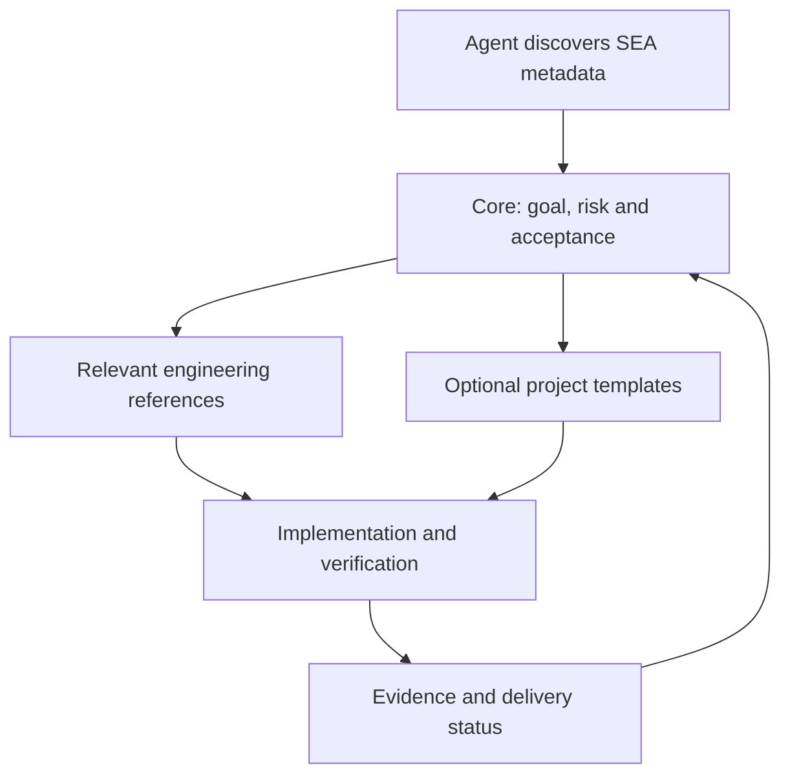

# SEA

**Software Engineering Assistant，软件工程助手**：面向 AI 编程助手、按风险裁剪流程的通用软件工程技能。

[English](README.md) | [简体中文](README.zh-CN.md)

SEA 将软件目标转化为明确需求、适度设计、可审查的实现和可核验的验证证据。技能正文、参考规范和模板统一使用英文；AI 仍应按用户偏好的语言交流。

## 快速安装

使用第三方 [skills CLI](https://github.com/vercel-labs/skills)，需要 Node.js 22.20+ 和 npm：

```sh
npx skills add quyuchao/SEA --skill sea
```

按提示选择 Agent，或指定：

```sh
npx skills add quyuchao/SEA --skill sea -a codex
npx skills add quyuchao/SEA --skill sea -a claude-code
```

在目标项目内执行；增加 `-g` 可安装到用户级。按宿主要求重新加载，然后要求使用 SEA（支持时使用 `$sea`），让 AI 说明实际读取的核心文件、任务风险与选用的参考规范。安装、宿主发现、实际选用是三个不同状态；自动选用取决于宿主。普通 ChatGPT 对话不能仅凭网址注册技能。本轮尚未完成端到端安装测试。

使用 `npx skills list` 检查安装，`npx skills check` 检查更新，`npx skills remove sea` 移除。更新或移除前核对安装范围。

## SEA 架构



`sea/` 为可安装包，核心按任务加载相关规范；仓库说明和 CI 面向维护者；`SEA.md` 是生成的纯聊天备用版，正常加载无需读取全部内容。

详见[架构审查](docs/architecture-review.md)（英文），包含改进优先级与验证边界。

## 覆盖范围

- 需求分析、验收条件、非功能要求和需求追踪。
- 瀑布/分阶段、迭代增量、V 模型验证思路及风险原型的选择。
- 架构、技术栈、语言/框架取舍与数据库设计。
- 模块职责、类的属性与操作、接口、状态和依赖关系。
- 按需使用上下文图、组件图、类图、时序图、状态图、流程图、ER 图和部署图。
- 分步实现、有效测试、自查、迁移、恢复和交付。
- 项目与任务管理：优先级、依赖、估算、风险、阻塞和技术债。
- 配置与变更管理：受控成果、基线、影响分析及追踪。
- Git/托管协作、前后端兼容、版本、制品、发布、部署及恢复。
- 运维、故障、维护、升级和退役。
- 独立、按需加载的量化交易扩展，不限制通用技能的适用范围。

小改动保持简洁，关键状态变更做更深入的设计和验证。不会要求每次修改都填写全部文档或绘制所有图。

## 如何使用

对于能读取项目文件的 AI，可以这样要求：

> 读取 sea/SKILL.md，按 SEA 处理本次任务。先检查当前实现，再按风险选择需求、设计、实现和验证步骤，报告实际证据，并用中文与我交流。

支持技能加载的平台，可根据该平台当前官方说明安装完整 [sea 目录](sea/SKILL.md)；支持名称调用时使用 `$sea`。不同平台的发现与安装机制不同，目前未验证所有平台的自动加载。

只支持聊天的 AI，可以提供 [SEA.md 单文件版](SEA.md)，其中包含核心和全部引用文档。没有文件或命令权限时，应给出方案及待执行检查，不能假装已经修改或测试。

## 文件组成

| 路径 | 用途 |
|---|---|
| [sea/SKILL.md](sea/SKILL.md) | 可独立执行的核心规范和按需加载入口 |
| [sea/references](sea/references/) | 需求、架构、设计、验证、跨 AI 使用、领域与来源规范 |
| [sea/assets/project-profile.md](sea/assets/project-profile.md) | 可选的项目、仓库、基线及交付约定模板 |
| [sea/assets/engineering-record.md](sea/assets/engineering-record.md) | 按风险裁剪的可选工程记录模板 |
| [sea/agents/openai.yaml](sea/agents/openai.yaml) | 可选的平台显示元数据 |
| [sea/scripts/check_skill.py](sea/scripts/check_skill.py) | 结构校验和单文件生成工具 |
| [SEA.md](SEA.md) | 从源文件生成的完整单文件版 |

## 项目与版本工作流

沿用已有任务和仓库约定，追踪需求验收、设计、影响组件、验证、提交、已授权的推送/评审、发布和部署，并分别记录各阶段结果。不会强制使用某个托管平台或分支模型，也不会按文件数量增加组件版本。

项目概况和工程记录模板按需使用，管理规范按任务加载。技能不会自动授权上传、公开发布或部署。

## 校验与重新生成

可选脚本需要 Python 3.10 或更高版本，仅使用标准库。在本仓库目录运行：

```sh
python sea/scripts/check_skill.py sea
python sea/scripts/check_skill.py sea --portable SEA.md
```

回归测试命令：`python -m unittest discover -s tests -v`。校验器只支持 SEA 的精简 frontmatter 格式：不加引号的名称，以及使用 JSON 双引号字符串表示的描述；它不是通用 YAML 解析器。平台元数据是可选项，存在时会核对调用名称。

先修改 sea 内的源文件，再重新生成 SEA.md。结构校验不能代替工程质量评审、实际测试、图表渲染或跨平台加载验证。

## 依据与边界

SEA 综合微软、Google、Apple、腾讯、DORA、Google SRE、IEEE SWEBOK 公开资料、NASA、GitHub、NIST 和 SLSA 的公开资料，详见[来源与采用边界](sea/references/sources.md)。它不是这些组织的官方产品，也不表示获得其背书；不要求使用企业专有工具或照搬其审批仪式。

技能不扩大 AI 的权限。上传、发布、联系他人或实盘交易仍取决于用户授权和宿主限制；软件测试通过不证明商业效果或投资收益。

## 许可证

使用 [MIT 许可证](LICENSE)。Copyright (c) 2026 quyuchao。引用的外部资料保留各自的许可。
