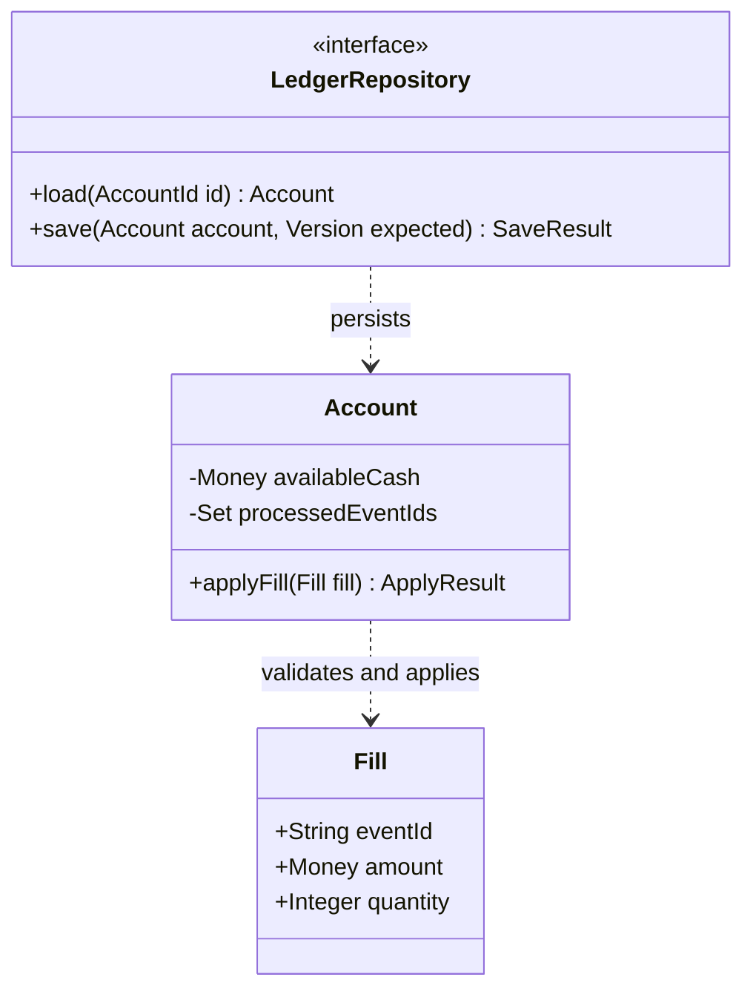

# Detailed design and diagrams

Establish responsibilities and invariants before choosing classes or functions. Use classes for state requiring controlled evolution, functions for pure transformations, and existing record types for boundary data. Do not create a class for every noun.

| Element | Design questions |
|---|---|
| Attributes | Name, type, unit, precision, default, nullability, mutability, visibility |
| Operations | Parameter/return types, preconditions/postconditions, errors, state changes, effects |
| Lifecycle | Valid initialization, resource ownership, disposal, cancellation, concurrency |
| Relationships | Composition/association/dependency/inheritance, multiplicity, contracts, substitution |

Express invariants as domain conditions. Private attributes do not automatically establish thread safety or transactional consistency; verify operation boundaries. Inheritance must preserve the parent contract instead of surprising callers with unsupported operations.

| Diagram | Question |
|---|---|
| Context | System, users, and external boundaries |
| Component | Module responsibilities and dependencies |
| Class | Attributes, operations, visibility, relationships, multiplicity |
| Sequence | Scenario calls, returns, and failure branches |
| State | States, events, guards, transitions |
| Activity/flow | Decisions and task steps |
| ER | Entities, keys, relationships, constraints |
| Deployment | Processes, nodes, environments, communication |

Label current versus target. Reference actual modules/symbols in current diagrams and identify unimplemented elements in targets. Keep each diagram purposeful and readable. Class diagrams do not replace flows; ER diagrams do not replace collaboration. A small fix does not require a complete diagram set.

Prefer text sources supported by the host. Use tables or existing tools for details Mermaid cannot accurately express. Do not claim rendering checks that were not performed.

The following is a design example, not an implemented project:

Diagram source does not prove idempotency, transactions, or concurrency correctness. Establish these through contracts, constraints, and verification evidence.
